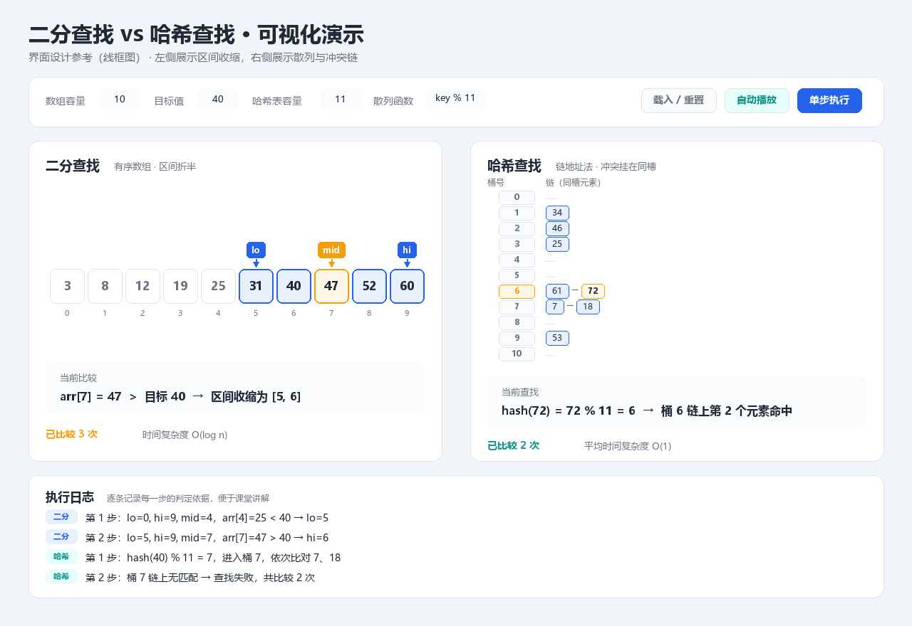

# 二分查找 vs 哈希查找：可视化对比演示

**项目组：Binary-vs-Hash-Search** ｜ **成员：6 人** ｜ **选题方向：经典查找算法的过程可视化**

> 对应《课程讲义》中「查找」与「算法时间复杂度」部分。作业原文允许的选题范围包含「经典排序 / 查找算法」，本选题属于该范围。

## 一、项目背景与目标

### 1.1 背景

二分查找与哈希查找是两种最基础的查找策略：前者用**有序性**把线性查找的 O(n) 降到 O(log n)，后者用**散列**换取平均 O(1)。课本给出的是结论，学生常常记住了公式，却说不清"为什么快"和"什么时候会慢"。

### 1.2 痛点

在课堂学习中，有三个环节特别抽象：

1. **二分的区间是怎么收缩的**——`lo`、`hi`、`mid` 三个变量在纸面上只是三个数字，看不出"每一步排除掉一半"的过程；
2. **哈希的冲突为什么影响效率**——散列函数把不同的 key 映射到同一个槽位，冲突链变长，查找就从 O(1) 退化成 O(n)；
3. **O(log n) 和 O(1) 差多少**——同样是 1000 个元素，一个要 10 次比较，一个平均 1 次多，这个差距只有画出来才有体感。

### 1.3 目标

开发一个**轻量级桌面演示程序**，把两种算法的执行过程逐步可视化，使用户能够：

- **单步观察**每一次比较的判定依据；
- **看到状态变化**：二分的区间边界、哈希的桶位与冲突链；
- **用数字对比效率**：同一组数据、同一个目标值，两侧实时统计比较次数，给出对比结论。

### 1.4 目标用户

本课程的同学（用于复习查找算法），以及后续学习该章节的学弟学妹。

## 二、核心功能需求

### 2.1 功能清单

1. **数据生成与输入**：支持一键生成指定规模的随机数组，也支持手动输入有序数组；目标值可自定义。
2. **二分查找可视化**：在有序数组上展示 `lo` / `hi` / `mid` 三个指针，每次比较后高亮被排除的区间，直到命中或区间为空。
3. **哈希查找可视化**：按 `key % 容量` 建立散列表，采用**链地址法**处理冲突，展示目标值落入哪个桶、在链上比对了几次。
4. **执行控制**：提供**单步执行**、**自动播放**（可调速度）、**重置**三种操作。
5. **执行日志**：下方日志面板逐条记录每一步的判定式子，例如 `arr[7]=47 > 40 → hi=6`。
6. **效率对比**：两侧分别统计比较次数，查找结束后给出结论（例如"二分 3 次 / 哈希 2 次"）。

### 2.2 功能与模块对照

| 功能 | 涉及模块 | 主要输出 |
| --- | --- | --- |
| 数据生成与输入 | `ui_layout.py` | 数组与目标值 |
| 二分查找可视化 | `algo_binary.py` + `render.py` | 步骤序列 → 画布 |
| 哈希查找可视化 | `algo_hash.py` + `render.py` | 步骤序列 → 画布 |
| 执行控制 | `main.py` | 状态机（就绪 / 运行 / 结束） |
| 执行日志 | `ui_layout.py` | 文本列表 |
| 效率对比 | `main.py` | 比较次数汇总 |

## 三、界面设计参考

整体采用**左右分栏 + 上下分区**的布局：顶部是参数与控制区，中间左右并排两个可视化面板，底部是共用日志面板。



### 3.1 区域划分

- **顶部控制区**：数组容量、目标值、哈希表容量、散列函数四个参数，右侧是「载入 / 重置」「自动播放」「单步执行」三个按钮。
- **左侧面板（二分查找）**：数组格子横向排列，`lo`（蓝）、`mid`（橙）、`hi`（蓝）三个标签用箭头指向对应下标；已排除的格子变灰，当前区间用蓝色描边。
- **右侧面板（哈希查找）**：11 个桶纵向排列，每个桶右侧挂一条冲突链；命中的桶与元素用橙色高亮。
- **底部日志区**：按时间顺序列出每一步的判定依据，二分用蓝色标签、哈希用绿色标签区分。

### 3.2 配色约定

| 用途 | 颜色 | 说明 |
| --- | --- | --- |
| 二分相关 | 蓝色 `#2563EB` | 区间、`lo` / `hi` 标签 |
| 哈希相关 | 青色 `#0D9488` | 桶、冲突链 |
| 当前操作 | 橙色 `#F59E0B` | `mid` 指针、命中元素 |
| 已排除 | 灰色 `#6B7280` | 被折半排除的区间 |

## 四、技术方案与模块划分

### 4.1 技术选型

| 项目 | 选择 | 理由 |
| --- | --- | --- |
| 语言 | Python 3.8+ | 课程推荐，语法门槛低 |
| 界面库 | Tkinter（标准库） | 无需 `pip install`，同学下载即可运行 |
| 绘图 | `tkinter.Canvas` | 直接绘制矩形、文字、线段，适合过程动画 |
| 版本控制 | Git + GitHub | 作业要求，使用分支隔离与 PR 流程 |

### 4.2 目录结构

```text
Binary-vs-Hash-Search/
├── README.md
├── Project_Requirements_and_Design.md
├── AI_Prompts_Log.md
├── docs/
│   ├── images/            截图与示意图
│   └── screenshots/       过程证据
├── src/
│   ├── main.py            入口、窗口装配、状态机
│   ├── ui_layout.py       界面布局与控件
│   ├── algo_binary.py     二分查找（输出步骤序列）
│   ├── algo_hash.py       哈希查找（输出步骤序列）
│   └── render.py          Canvas 绘制与动画
└── tests/
    └── test_algorithms.py 单元测试
```

### 4.3 接口契约

两个算法模块与渲染模块之间，通过**统一的步骤结构**通信。任何一方都不得私自修改字段名。

```python
# 统一的「一步」结构，两个算法模块都必须产出这个格式
Step = {
    "type": "compare" | "hit" | "miss" | "shrink" | "probe",
    "lo": int,          # 二分：当前左边界
    "hi": int,          # 二分：当前右边界
    "mid": int,         # 二分：当前中点
    "slot": int,        # 哈希：当前桶号
    "chain_pos": int,   # 哈希：链上第几个元素
    "message": str,     # 中文说明，直接显示在日志面板
}

# src/algo_binary.py
def binary_search_steps(arr: list[int], target: int) -> dict:
    """返回 {"found": bool, "index": int | None, "steps": list[Step], "comparisons": int}"""

# src/algo_hash.py
def hash_search_steps(keys: list[int], target: int, size: int = 11) -> dict:
    """返回 {"found": bool, "slot": int | None, "steps": list[Step], "comparisons": int}"""
```

**这样约定的好处**：`render.py` 只需要消费 `list[Step]`，不必关心数据来自二分还是哈希；`ui_layout.py` 的日志面板只显示 `Step["message"]`。

### 4.4 运行方式

```bash
git clone https://github.com/favor177/Binary-vs-Hash-Search.git
cd Binary-vs-Hash-Search
python src/main.py
```

无需安装任何第三方依赖。

## 五、团队分工协作表

| 姓名 | 学号 | 组内角色 | 任务分工 | 负责分支 |
| --- | --- | --- | --- | --- |
| 刘硕 | 2610250340 | 组长 / 项目经理 | 统筹进度、制定 Git 规范、编写接口契约、主程序装配、PR 审查与合并、README 维护 | `feat/liushuo-*`、`chore/*` |
| 赵森森 | 2610250248 | 界面开发 | 主窗口布局、参数输入区、执行按钮、日志面板、整体配色与样式 | `feature/yuhuyuyuqun-ui` |
| 侯果果 | 2610251481 | 算法 · 二分查找 | 二分查找流程实现，输出 `lo` / `hi` / `mid` 每一步的变化序列与比较次数 | `feature/houguoguo1106-binary` |
| 刘红瑶 | 2610250102 | 算法 · 哈希查找 | 散列表构建、取模散列函数、链地址法冲突处理、查找路径与比较次数输出 | `feature/liu666code-hash` |
| 吴馨瑜 | 2610250130 | 可视化渲染 | Canvas 绘制数组格子、指针标签、哈希桶与冲突链，单步高亮与播放动画 | `feature/wxy-render` |
| 张谨洋 | 2610250240 | 测试与文档 | 单元测试与边界用例、需求文档撰写与维护、`AI_Prompts_Log.md` 整理 | `test/pingjingdenaiwa-qa` |

> **协作规则**：任何人都不得直接向 `main` 推送，所有改动必须走「功能分支 → Pull Request → 组长审查 → 合并」。

## 六、测试与验收标准

### 6.1 功能验收

| 测试项 | 输入 | 预期输出 |
| --- | --- | --- |
| 二分 · 正常命中 | `[3,8,12,19,25,31,40,47,52,60]`，目标 `40` | 找到下标 6，比较次数 ≤ 4 |
| 二分 · 目标不存在 | 同上，目标 `41` | 返回未找到，`lo > hi` 时终止 |
| 二分 · 单元素 | `[5]`，目标 `5` | 1 次比较命中 |
| 二分 · 空数组 | `[]`，目标 `5` | 不崩溃，提示"数组为空" |
| 哈希 · 正常命中 | 容量 11，keys 含 `72`，目标 `72` | 桶 6 命中，比较次数 = 链上位置 |
| 哈希 · 目标不存在 | 同上，目标 `99` | 桶位链走完无匹配，返回未找到 |
| 哈希 · 全冲突 | 容量 5，keys 全为 5 的倍数 | 链长度为 n，比较次数 = n |
| 哈希 · 表为空 | 无 keys，目标任意 | 不崩溃，提示"散列表为空" |

### 6.2 非功能验收

- **界面**：窗口缩放时各区域不重叠、不缺字；控件对齐，字号统一。
- **交互**：单步执行每次只前进一格，自动播放可中途暂停与重置。
- **稳定性**：连续点击「重置」与「自动播放」20 次不崩溃、不卡顿。
- **可读性**：日志文字为中文，能脱离代码独立读懂每一步在做什么。

### 6.3 交付验收

- 仓库为公开状态，教师可直接访问；
- 包含完整的 commit 历史、分支记录与 PR 记录；
- 交付物齐备：`README.md`、`Project_Requirements_and_Design.md`、`AI_Prompts_Log.md`、`src/` 全部源码。

---

## 修订记录

> 选题审核阶段使用。老师每给一条意见，在这里记一条，改完补上对应小节。

| 日期 | 老师意见 | 我们的修改 | 涉及小节 |
| --- | --- | --- | --- |
| | | | |